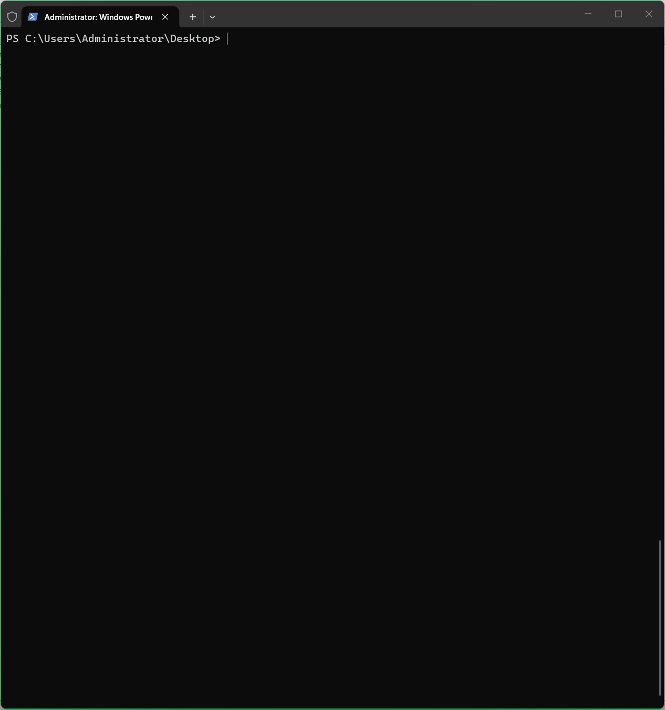

# Windows Isolated Sandbox Account Generator

A lightweight PowerShell automation script designed to create an isolated local Windows standard user with customized directory and drive access controls. It streamlines security containment while bypassing all tedious first-logon setup screens.

---

## Demo Preview



## Key Features

- **Automated Parameter Support**: Run interactively or supply arguments directly (`.\nameofthescript.ps1 <username> <target_folder>`).
- **Interactive Drive Access Control**: Enumerates all fixed drives with per-drive options (`Deny All`, `Read-Only`, `Read/Write`, or `Skip`).
- **System Drive Safeguard**: Automatically protects `C:\` to prevent breaking the operating system and account logon.
- **Directory Isolation**: Strips inherited permissions on your specified folder and grants dedicated access (`Full Control`, `Modify`, or `Read & Execute`).
- **Zero-Friction First Logon**: Automatically suppresses the Windows OOBE privacy screens, initial logon animation ("Hi / Getting things ready"), and Microsoft Edge welcome guides.
- **Bilingual Interface**: Automatically detects system UI language and displays prompts in English or Chinese.

---

## Requirements

- **OS**: Windows 10 / Windows 11 / Windows Server 2016+
- **Privileges**: Administrator permissions (PowerShell run as Administrator)
- **Filesystem**: NTFS drives (for ACL manipulation)

---

## Quick Start

### 1. Run Interactively

Open PowerShell as **Administrator** and run the script, you should paste it in to a nameofthescript.ps1 file before:

```powershell
Set-ExecutionPolicy -Scope Process -ExecutionPolicy Bypass
.\nameofthescriipt.ps1

```powershell

#Requires -RunAsAdministrator

<#
.SYNOPSIS
    创建具有驱动器和目录访问控制的 Windows 本地隔离账户。
.DESCRIPTION
    交互式创建一个本地标准用户，并使用权限控制模型将其文件系统访问限制在指定目录。
    支持遍历检测系统中所有固定驱动器并秒级配置读写/只读/禁止访问权限。
    自动将新账户加入 BUILTIN\Users 组以保障交互登录，并保护系统盘（C盘）禁止完全封锁。

.NOTES
    需要：管理员权限
    版本：3.4
#>

param(
    [string]$Username,
    [string]$TargetPath
)

# --- 语言检测 ---
$lang = if ((Get-UICulture).Name -like "zh-*") { "zh" } else { "en" }

$strings = @{
    "en" = @{
        ErrNotAdmin             = "This script requires Administrator privileges. Please re-run as Administrator."
        PromptUsername          = "Enter username for the new account (e.g., sandbox-user)"
        ErrEmptyUsername        = "Username cannot be empty."
        ErrUserExists           = "User '{0}' already exists. Aborting."
        PromptPath              = "Enter folder path to isolate (press Enter for: '{0}')"
        ErrPathInvalid          = "Path '{0}' does not exist or is not a directory. Aborting."
        PromptPassword          = "Set password for '{0}'"
        ErrEmptyPassword        = "Password cannot be empty. Aborting."
        PromptFullName          = "Account Full Name (press Enter for '{0}')"
        PromptDescription       = "Account Description (max 48 chars, press Enter for '{0}')"
        ErrDescTooLong          = "Description cannot exceed 48 characters. Current length: {0}."
        PromptPermLevel         = "Select folder permission level for '{0}':`n  [1] Full Control (F)`n  [2] Modify / Read-Write (M)`n  [3] Read & Execute (RX)`nChoice (1-3, default: 1)"
        DriveSectionHeader      = "`n--- Configure Access for System Drives ---"
        PromptSystemDriveAccess = "Access for SYSTEM drive [{0}] ({1}, Free: {2} GB) [Deny access is disabled to ensure logon]:`n  [1] Default / Skip (Recommended)`n  [2] Read-Only (RX)`n  [3] Full Read & Write (M)`nChoice (1-3, default: 1)"
        PromptDriveAccess       = "Access for data drive [{0}] ({1}, Free: {2} GB):`n  [1] Deny All Access (No Read / No Write)`n  [2] Read-Only (RX)`n  [3] Full Read & Write (M)`n  [4] Default / Skip`nChoice (1-4, default: 1)"
        WarnTargetDriveDeny     = "Note: Drive {0} contains target folder. Applying folder-specific override."

        CreatingUser            = "Creating user '{0}'..."
        UserCreated             = "User '{0}' created successfully."
        AddedToUsersGroup       = "User '{0}' successfully added to default 'Users' group."
        ConfiguringDrives       = "Configuring drive access permissions..."
        DrivePermSet            = "Drive [{0}] permission applied: {1}"
        LockingFolder           = "Applying isolated permissions to '{0}'..."
        ErrDisableInherit       = "Failed to break inheritance on '{0}'."
        ErrGrantPerm            = "Failed to grant ACL '{0}'."
        PermissionsSet          = "Folder ACL configured successfully."
        Complete                = "All done! User '{0}' is restricted to '{1}'."
        ErrGeneric              = "An error occurred: {0}"
    }
    "zh" = @{
        ErrNotAdmin             = "此脚本需要管理员权限，请以管理员身份重新运行。"
        PromptUsername          = "请输入新账户用户名 (例如: sandbox-user)"
        ErrEmptyUsername        = "用户名不能为空。"
        ErrUserExists           = "用户 '{0}' 已存在，操作中止。"
        PromptPath              = "请输入要隔离的文件夹路径 (直接回车使用当前目录: '{0}')"
        ErrPathInvalid          = "路径 '{0}' 不存在或不是目录，操作中止。"
        PromptPassword          = "请为用户 '{0}' 设置密码"
        ErrEmptyPassword        = "密码不能为空，操作中止。"
        PromptFullName          = "用户全名 (直接回车默认: '{0}')"
        PromptDescription       = "账户描述 (不能超过 48 个字符，直接回车默认: '{0}')"
        ErrDescTooLong          = "描述长度不能超过 48 个字符，当前长度: {0}。"
        PromptPermLevel         = "请选择对目标文件夹的授权级别:`n  [1] 完全控制 (Full Control - F)`n  [2] 读写/修改 (Modify - M)`n  [3] 只读与执行 (Read & Execute - RX)`n请输入选项 (1-3，默认: 1)"
        DriveSectionHeader      = "`n--- 配置驱动器全局访问控制 ---"
        PromptSystemDriveAccess = "配置系统引导盘 [{0}] 访问权限 (卷标: {1}, 剩余空间: {2} GB) [为确保正常登录，已禁用完全禁止选项]:`n  [1] 保持系统默认 / 跳过 (推荐)`n  [2] 只读访问 (允许读取与执行，禁止写入)`n  [3] 完全读写 (允许读取与写入)`n请输入选项 (1-3，默认: 1)"
        PromptDriveAccess       = "配置数据驱动器 [{0}] 访问权限 (卷标: {1}, 剩余空间: {2} GB):`n  [1] 完全禁止访问 (无法读取/无法写入)`n  [2] 只读访问 (允许读取与执行，禁止写入)`n  [3] 完全读写 (允许读取与写入)`n  [4] 保持默认 / 跳过`n请输入选项 (1-4，默认: 1)"
        WarnTargetDriveDeny     = "提示: 驱动器 {0} 包含目标工作目录，将仅对根目录施加限制并放行目标子目录。"

        CreatingUser            = "正在创建用户 '{0}'..."
        UserCreated             = "用户 '{0}' 创建成功。"
        AddedToUsersGroup       = "用户 '{0}' 已成功加入系统 'Users' 用户组。"
        ConfiguringDrives       = "正在配置各驱动器权限..."
        DrivePermSet            = "驱动器 [{0}] 权限已应用: {1}"
        LockingFolder           = "正在为 '{0}' 应用隔离权限..."
        ErrDisableInherit       = "无法在 '{0}' 上禁用权限继承。"
        ErrGrantPerm            = "授予权限 '{0}' 失败。"
        PermissionsSet          = "目标文件夹访问控制权限已成功应用。"
        Complete                = "配置完成！用户 '{0}' 的访问已被严格限制在 '{1}'。"
        ErrGeneric              = "发生错误: {0}"
    }
}
$L = $strings[$lang]

# --- 检查管理员权限 ---
$isAdmin = ([Security.Principal.WindowsPrincipal][Security.Principal.WindowsIdentity]::GetCurrent()).IsInRole(
    [Security.Principal.WindowsBuiltInRole]::Administrator)
if (-not $isAdmin) {
    Write-Host $L.ErrNotAdmin -ForegroundColor Red
    return
}

try {
    # 1. 用户名（若命令行已传参则直接使用）
    $finalUsername = $Username
    if ([string]::IsNullOrWhiteSpace($finalUsername)) {
        $finalUsername = Read-Host -Prompt $L.PromptUsername
    }
    if ([string]::IsNullOrWhiteSpace($finalUsername)) {
        throw $L.ErrEmptyUsername
    }
    if (Get-LocalUser -Name $finalUsername -ErrorAction SilentlyContinue) {
        throw ($L.ErrUserExists -f $finalUsername)
    }

    # 2. 隔离目录
    $defaultPath = (Get-Location).Path
    $finalPath = $TargetPath
    if ([string]::IsNullOrWhiteSpace($finalPath)) {
        $finalPath = Read-Host -Prompt ($L.PromptPath -f $defaultPath)
    }
    if ([string]::IsNullOrWhiteSpace($finalPath)) {
        $finalPath = $defaultPath
    }
    if (-not (Test-Path -LiteralPath $finalPath -PathType Container)) {
        throw ($L.ErrPathInvalid -f $finalPath)
    }
    $finalPath = (Resolve-Path -LiteralPath $finalPath).Path
    $targetDrive = (Get-Item -LiteralPath $finalPath).PSDrive.Name.ToUpper() + ":"
    $sysDrive = $env:SystemDrive.ToUpper()

    # 3. 密码
    $password = Read-Host -Prompt ($L.PromptPassword -f $finalUsername) -AsSecureString
    if ($password.Length -eq 0) {
        throw $L.ErrEmptyPassword
    }

    # 4. 全名 (Full Name) 自定义
    $defaultFullName = "Sandbox Account"
    $inputFullName = Read-Host -Prompt ($L.PromptFullName -f $defaultFullName)
    $finalFullName = if ([string]::IsNullOrWhiteSpace($inputFullName)) { $defaultFullName } else { $inputFullName }

    # 5. 描述 (Description) 自定义与 SAM 48 字符校验
    $defaultDesc = "Sandbox account"
    $inputDesc = Read-Host -Prompt ($L.PromptDescription -f $defaultDesc)
    $finalDesc = if ([string]::IsNullOrWhiteSpace($inputDesc)) { $defaultDesc } else { $inputDesc }
    if ($finalDesc.Length -gt 48) {
        throw ($L.ErrDescTooLong -f $finalDesc.Length)
    }

    # 6. 目标目录授权级别
    Write-Host ($L.PromptPermLevel -f $finalUsername) -ForegroundColor Yellow
    $permLevelChoice = Read-Host -Prompt ">"
    $userPermission = switch ($permLevelChoice.Trim()) {
        "2" { "M" }
        "3" { "RX" }
        Default { "F" }
    }

    # 7. 遍历所有固定驱动器配置读写访问权限
    Write-Host $L.DriveSectionHeader -ForegroundColor Cyan
    $fixedDrives = Get-CimInstance Win32_LogicalDisk -Filter "DriveType = 3"
    $driveConfigList = @()

    foreach ($drive in $fixedDrives) {
        $dLetter = $drive.DeviceID
        $volName = if ($drive.VolumeName) { $drive.VolumeName } else { "Local Disk" }
        $freeGB  = [math]::Round($drive.FreeSpace / 1GB, 1)

        Write-Host ""
        if ($dLetter.ToUpper() -eq $sysDrive) {
            # 系统引导盘（C:）不可禁止访问，防止用户配置文件无法初始化
            Write-Host ($L.PromptSystemDriveAccess -f $dLetter, $volName, $freeGB) -ForegroundColor Yellow
            $dChoice = Read-Host -Prompt ">"
            $mappedAction = switch ($dChoice.Trim()) {
                "2"     { "RX" }
                "3"     { "M" }
                Default { "SKIP" }
            }
        }
        else {
            # 数据盘可完整配置
            Write-Host ($L.PromptDriveAccess -f $dLetter, $volName, $freeGB) -ForegroundColor Yellow
            $dChoice = Read-Host -Prompt ">"
            $mappedAction = switch ($dChoice.Trim()) {
                "2"     { "RX" }
                "3"     { "M" }
                "4"     { "SKIP" }
                Default { "DENY" }
            }
        }

        $driveConfigList += [PSCustomObject]@{
            DriveID = $dLetter
            Action  = $mappedAction
        }
    }

    Write-Host "`n================== 开始执行配置 ==================" -ForegroundColor Cyan

    # 执行创建本地标准用户
    Write-Host ($L.CreatingUser -f $finalUsername) -ForegroundColor Cyan
    New-LocalUser -Name $finalUsername `
        -Password $password `
        -FullName $finalFullName `
        -Description $finalDesc | Out-Null
    Write-Host ($L.UserCreated -f $finalUsername) -ForegroundColor Green

    # 将新账户明确加入 BUILTIN\Users 组（SID: S-1-5-32-545，跨语言系统通用）
    $builtinUsers = Get-LocalGroup | Where-Object { $_.SID -eq 'S-1-5-32-545' }
    if ($builtinUsers) {
        Add-LocalGroupMember -Group $builtinUsers.Name -Member $finalUsername -ErrorAction SilentlyContinue
    } else {
        Add-LocalGroupMember -Group "Users" -Member $finalUsername -ErrorAction SilentlyContinue
    }
    Write-Host ($L.AddedToUsersGroup -f $finalUsername) -ForegroundColor Green

    # 遍历配置驱动器权限
    Write-Host $L.ConfiguringDrives -ForegroundColor Cyan

    foreach ($cfg in $driveConfigList) {
        # 注意：使用双反斜杠 '\\' 防止 PowerShell 将尾部 '\' 与引号结合导致参数转义损坏
        $safeDriveRoot = "$($cfg.DriveID)\\"
        $isTargetDrive = ($cfg.DriveID.ToUpper() -eq $targetDrive)

        switch ($cfg.Action) {
            "DENY" {
                if ($isTargetDrive) {
                    Write-Host ($L.WarnTargetDriveDeny -f $cfg.DriveID) -ForegroundColor DarkYellow
                    & icacls.exe $safeDriveRoot /deny "${finalUsername}:(NP)(OI)(CI)F" /q | Out-Null
                } else {
                    & icacls.exe $safeDriveRoot /deny "${finalUsername}:(OI)(CI)F" /q | Out-Null
                }
                Write-Host ($L.DrivePermSet -f $cfg.DriveID, "Deny") -ForegroundColor Green
            }
            "RX" {
                & icacls.exe $safeDriveRoot /grant "${finalUsername}:(OI)(CI)RX" /q | Out-Null
                Write-Host ($L.DrivePermSet -f $cfg.DriveID, "ReadOnly (RX)") -ForegroundColor Green
            }
            "M" {
                & icacls.exe $safeDriveRoot /grant "${finalUsername}:(OI)(CI)M" /q | Out-Null
                Write-Host ($L.DrivePermSet -f $cfg.DriveID, "ReadWrite (M)") -ForegroundColor Green
            }
            Default {
                # 跳过
            }
        }
    }

    # 配置目标隔离目录 ACL
    Write-Host ($L.LockingFolder -f $finalPath) -ForegroundColor Cyan
    & icacls.exe $finalPath /inheritance:r /q | Out-Null
    if ($LASTEXITCODE -ne 0) { throw ($L.ErrDisableInherit -f $finalPath) }

    $grants = @(
        "SYSTEM:(OI)(CI)F",
        "Administrators:(OI)(CI)F",
        "${finalUsername}:(OI)(CI)${userPermission}"
    )
    foreach ($grant in $grants) {
        & icacls.exe $finalPath /grant $grant /q | Out-Null
        if ($LASTEXITCODE -ne 0) { throw ($L.ErrGrantPerm -f $grant) }
    }
    Write-Host $L.PermissionsSet -ForegroundColor Green

    Write-Host "==================================================" -ForegroundColor Green
    Write-Host ($L.Complete -f $finalUsername, $finalPath) -ForegroundColor Green
    Write-Host "==================================================" -ForegroundColor Green
}
catch {
    Write-Host ($L.ErrGeneric -f $_.Exception.Message) -ForegroundColor Red
}
```
